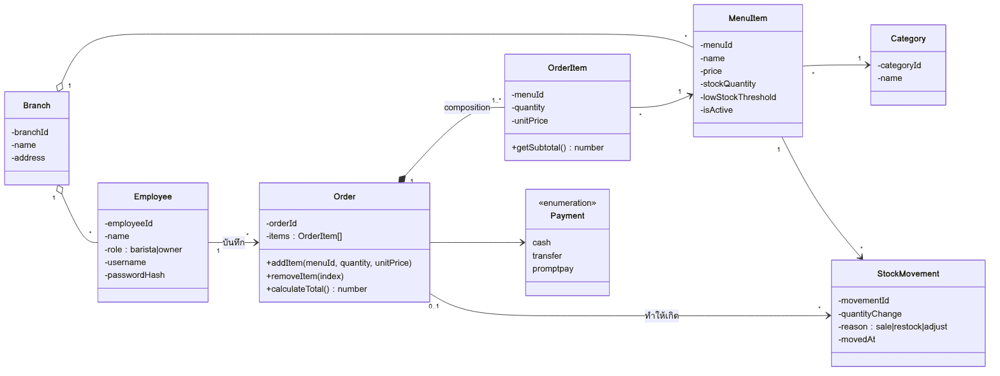
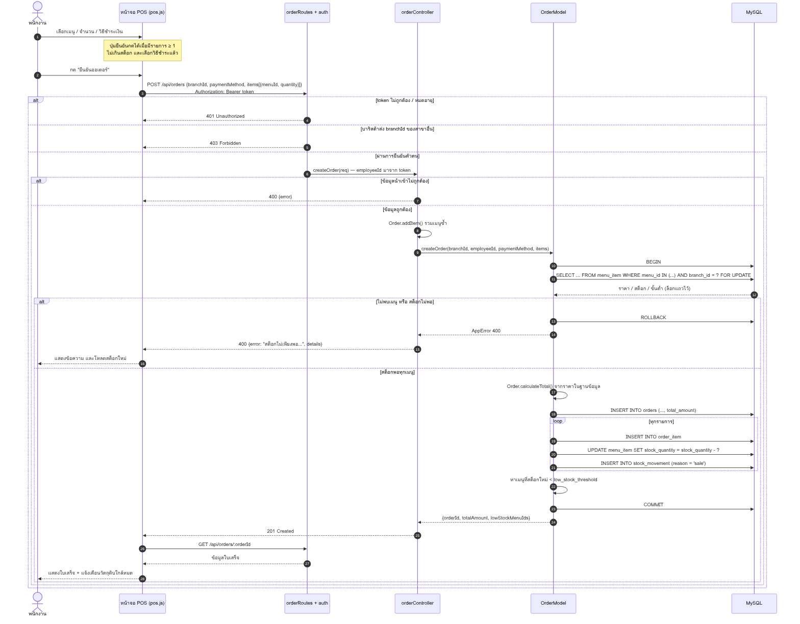
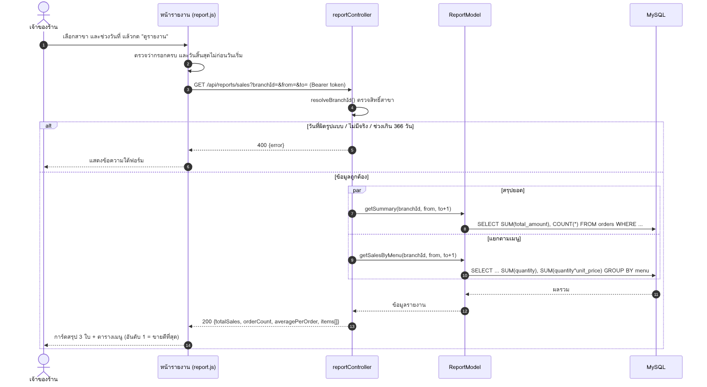
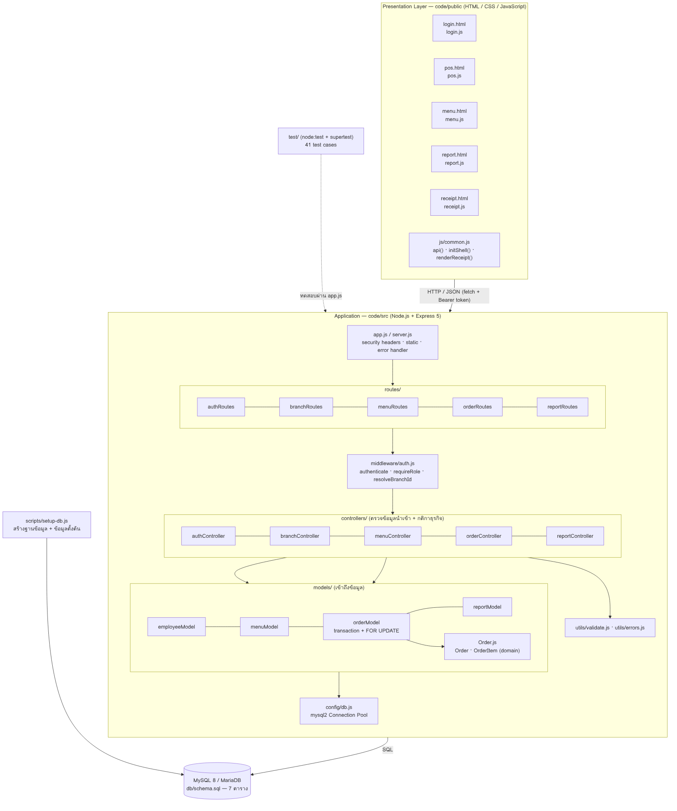
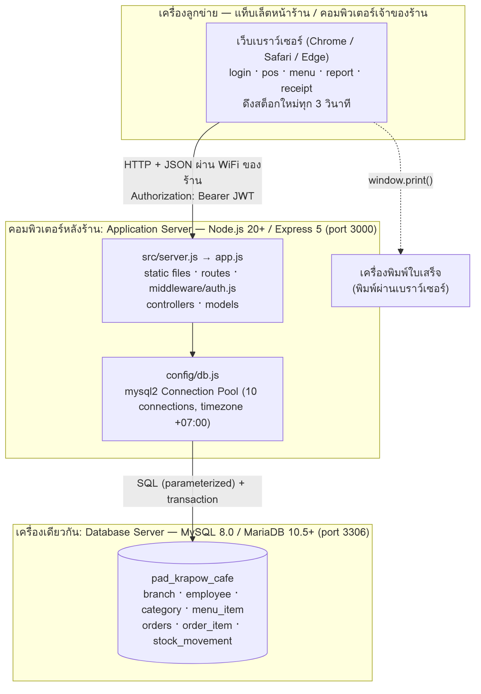

# สถาปัตยกรรมระบบ Pad-Krapow-cafe-system (4+1 Architectural View Model)

## สัปดาห์ที่ 11: การออกแบบระบบ — สถาปัตยกรรมและการแบ่ง Component (4+1 View)

**กลุ่มที่ 1:** Pad-Krapow-cafe
**สมาชิกกลุ่ม:**

1. 67160031 นายธีรเดช อยู่คง
2. 67160030 นายดรัณภพ ทวีพูล
3. 67160039 นายภัคพล ใบเนียม
4. 67160047 นายอภิชาติ ชนะชัย
5. 67160018 นายภูมิพัฒน์ ขันอาสา

> **ประวัติเอกสาร:** ฉบับแรก (สัปดาห์ 11) มีเฉพาะ Physical View และ Development View และระบุว่าชั้น Routes/Controllers ยังเป็น "แนวคิด" เพราะ repository มีแค่ `orderModel.js` กับ `menuModel.js` ฉบับนี้ (ปรับหลัง Coding Sprint สัปดาห์ 13) เพิ่ม Logical, Process และ Scenarios View ให้ครบ 4+1 และอัปเดต Development View ให้ตรงกับโค้ดที่มีอยู่จริงใน `code/` แล้ว Diagram ฉบับแรกเก็บไว้ที่ `images/v1/` (`wk11-development-view-v1.png`, `wk11-physical-view-v1.png`)

---

## ภาพรวม

ระบบเป็น **Monolithic ที่แบ่งชั้นภายใน (Layered)** แบบ 3-Tier:

| Tier | เทคโนโลยี | อยู่ที่ |
|---|---|---|
| Presentation | HTML / CSS / JavaScript (ไม่ใช้ framework) | `code/public/` |
| Application | Node.js + Express 5 | `code/src/` |
| Data | MySQL 8 (หรือ MariaDB 10.5+) | `code/db/schema.sql` |

---

## 1. Logical View: โครงสร้างเชิงฟังก์ชันและข้อมูล



- ต่อยอดจาก Class Diagram สัปดาห์ 6: `Order` กับ `OrderItem` เป็น **Composition** (OrderItem ไม่มีความหมายถ้าไม่มี Order) ในโค้ดคือ `code/src/models/Order.js` มีเมธอด `calculateTotal()`, `removeItem(index)`, `getSubtotal()` ตาม diagram และเพิ่ม `addItem()` สำหรับรวมเมนูซ้ำตาม Sequence Diagram สัปดาห์ 9
- เอนทิตีอื่นมาจาก ER Diagram สัปดาห์ 7 (`wk07-er-diagram.png`) ได้แก่ `MenuItem`, `Category`, `Branch`, `Employee`, `StockMovement`
- ฟังก์ชันหลักแบ่งเป็น 5 กลุ่ม ซึ่งตรงกับไฟล์ controller: **Auth**, **Branch**, **Menu & Stock**, **Order (POS)**, **Report**

## 2. Process View: ลำดับการทำงานขณะระบบทำงาน

**สร้างออเดอร์ (`POST /api/orders`)** — ปรับจาก Sequence Diagram สัปดาห์ 9 ให้ตรงกับโค้ดจริง



**รายงานยอดขาย (`GET /api/reports/sales`)** — จากร่างในเอกสาร Input/Output Design สัปดาห์ 10



ประเด็นด้านการทำงานพร้อมกัน (concurrency):

1. Node.js รับคำขอพร้อมกันได้หลายคำขอใน process เดียว และใช้ **Connection Pool 10 connection** ไปยัง MySQL
2. การสร้างออเดอร์เป็น **transaction เดียว** และล็อกแถวเมนูด้วย `SELECT ... FOR UPDATE` เรียงตาม `menu_id` ถ้าสองเครื่องขายเมนูเดียวกันพร้อมกัน เครื่องที่สองจะรอจนเครื่องแรก commit แล้วจึงเห็นสต็อกใหม่ ทดสอบแล้วว่ายิง 8 ออเดอร์พร้อมกันบนสต็อก 3 ชิ้น ขายได้ 3 ปฏิเสธ 5 (TC-20)
3. หน้า POS ดึงข้อมูลเมนู/สต็อกใหม่ทุก 3 วินาที เพื่อให้ทุกเครื่องเห็นสต็อกตรงกันตาม NFR-04

## 3. Development View: การแบ่ง Component และ Module ของ Source Code



```
code/
├── package.json            สคริปต์ start / dev / test / db:setup
├── .env.example            ตัวอย่างค่าตั้งค่า (ไฟล์ .env จริงไม่ถูก commit)
├── db/schema.sql           โครงสร้างฐานข้อมูล (ตรงกับ docs/wk07-schema.sql)
├── scripts/setup-db.js     สร้างฐานข้อมูลใหม่ + ข้อมูลตั้งต้น (+ ข้อมูลตัวอย่างด้วย --demo)
├── src/
│   ├── server.js           เปิด HTTP server
│   ├── app.js              ประกอบ Express: security headers, static, routes, error handler
│   ├── config/db.js        mysql2 Connection Pool (timezone +07:00)
│   ├── middleware/auth.js  ตรวจ JWT, ตรวจบทบาท, ตรวจสิทธิ์สาขา
│   ├── routes/             auth, branch, menu, order, report
│   ├── controllers/        ตรวจข้อมูลนำเข้า + กติกาธุรกิจ
│   ├── models/             Order.js (domain), employeeModel, menuModel, orderModel, reportModel
│   └── utils/              validate.js, errors.js
├── public/                 หน้าจอ: login, pos, menu, report, receipt + css/ + js/
└── test/                   unit.test.js, api.test.js (41 test cases)
```

### การตรวจสอบความสอดคล้องกับ Repository จริง

| องค์ประกอบใน diagram | สถานะใน repository | หมายเหตุ |
|---|---|---|
| Presentation (`public/*.html`, `public/js/*.js`) | **มีอยู่จริง** | 5 หน้าจอตาม wireframe สัปดาห์ 10 + `common.js` ที่ใช้ร่วมกัน |
| Routes (`authRoutes`, `branchRoutes`, `menuRoutes`, `orderRoutes`, `reportRoutes`) | **มีอยู่จริง** | ฉบับแรกเป็น "แนวคิด" มี 3 ไฟล์ เพิ่ม auth และ branch ตาม FR-13 |
| Middleware (`auth.js`) | **มีอยู่จริง** | ไม่มีในฉบับแรก เพิ่มเพื่อทำ login และกันการเข้าถึงข้ามสาขา |
| Controllers (5 ไฟล์) | **มีอยู่จริง** | ทำหน้าที่ validation ตาม Sequence Diagram |
| `orderModel.js` | **มีอยู่จริง (ปรับปรุง)** | `createOrder(branchId, employeeId, paymentMethod, items)` ชื่อและพารามิเตอร์เดิม เพิ่มการล็อกแถว ตรวจสต็อก ใช้ราคาจากฐานข้อมูล และเขียน `stock_movement` |
| `menuModel.js` | **มีอยู่จริง (ปรับปรุง)** | `getByBranch`, `getById`, `updateStock` ชื่อเดิม `updateStock` ตัดได้เฉพาะเมื่อสต็อกพอ และเพิ่มฟังก์ชันจัดการเมนู |
| Domain `Order.js` | **มีอยู่จริง** | ฉบับแรกระบุว่ายังไม่มีไฟล์ตามข้อบังคับสัปดาห์ 6 ตอนนี้มีแล้ว และถูกใช้ทั้งใน controller และ model |
| `config/db.js` | **มีอยู่จริง** | ฉบับแรกเป็นเพียง "อ้างอิงจากโค้ด" |
| `schema.sql` | **มีอยู่จริง** | 7 ตาราง เพิ่มคอลัมน์และ CHECK (ดูท้ายไฟล์ `wk07-schema.sql`) |

### ข้อจำกัดที่ diagram ต้องสื่อตามความเป็นจริง

1. **ยังไม่รองรับการทำงาน offline:** ถ้าเชื่อม server ไม่ได้ หน้าจอแจ้งเตือนและไม่บันทึกออเดอร์
2. **การอัปเดตสต็อกข้ามเครื่องใช้การดึงข้อมูลทุก 3 วินาที** ไม่ใช่ push แบบทันที
3. **ยังไม่มีการยกเลิก/คืนเงินออเดอร์**
4. **การเชื่อมต่อยังเป็น HTTP** เหมาะกับเครือข่ายภายในร้านเท่านั้น

ข้อจำกัดที่ฉบับแรกระบุไว้ (ไม่ตรวจสต็อกก่อนตัด, ไม่ใช้ `stock_movement`, Routes/Controllers เป็นแนวคิด) **แก้แล้วทั้งหมด** และมี test ยืนยัน (TC-15, TC-20, TC-10)

---

## 4. Physical View: โครงสร้างทางกายภาพและการติดตั้งระบบ (Deployment Topology)



### คำอธิบายประกอบ Physical View

1. **จำนวน Node:** ระบบแบ่งเป็น 3 node เชิงตรรกะ ได้แก่ เครื่องลูกข่าย (Web Browser ของพนักงาน POS/เจ้าของร้าน), Application Server (Node.js / Express) และ Database Server (MySQL) ตามขอบเขตโครงงาน ทั้งสามส่วนรันอยู่บนเครื่องเดียว (เครื่องพัฒนาของกลุ่ม หรือคอมพิวเตอร์หลังร้าน) ไม่มีการ deploy ขึ้น cloud และไม่มี load balancer แท็บเล็ตในร้านเข้าผ่าน WiFi ด้วย `http://<IP เครื่องหลังร้าน>:3000`
2. **การสื่อสารระหว่าง node:**
   * Browser → Application Server ใช้ HTTP แลกเปลี่ยนข้อมูลแบบ JSON พร้อม header `Authorization: Bearer <token>`
   * Application Server → Database Server ส่งคำสั่ง SQL ผ่าน Connection Pool ใน `config/db.js` (mysql2)
3. **โครงสร้างฐานข้อมูล:** ใช้ schema ตาม `wk07-schema.sql` มี 7 ตาราง ได้แก่ `branch`, `employee`, `category`, `menu_item`, `orders`, `order_item`, `stock_movement`
4. **การรองรับหลายสาขา:** จำลองหลายสาขาด้วยคอลัมน์ `branch_id` (ตาราง `employee`, `menu_item`, `orders`) ในฐานข้อมูลชุดเดียว ไม่มี Database Server แยกตามสาขา และไม่มีการ sync ข้อมูลข้ามสาขา

---

## 5. Scenarios View (+1): Use Case ที่ใช้ตรวจว่าสถาปัตยกรรมรองรับได้

| Scenario | Use Case / Story | ผ่าน Component ไหนบ้าง |
|---|---|---|
| S1 บาริสต้ารับออเดอร์ Latte 2 + Mocha 1 จ่ายเงินสด | UC-01, US-01–05 | `pos.js` → `orderRoutes` → `auth` → `orderController` → `Order.js` → `orderModel` (transaction) → MySQL → ใบเสร็จ |
| S2 สั่งเมนูที่หมดสต็อก | UC-01 Exception, FR-10 | หน้าจอกันไว้ก่อน + `orderModel` ตรวจซ้ำแล้ว rollback ตอบ 400 |
| S3 ขายจนสต็อกต่ำกว่าขั้นต่ำ | US-06 | `orderModel` คืน `lowStockMenuIds` → `pos.js` แสดง toast และแถบเตือน |
| S4 เจ้าของร้านดูยอดขายวันนี้ / เดือนนี้ และเมนูขายดี | US-07, US-08 | `report.js` → `reportController` → `reportModel` (SUM / GROUP BY) |
| S5 บาริสต้าสาขา 1 พยายามดูข้อมูลสาขา 2 | FR-13 | `middleware/auth.js` → `resolveBranchId()` ตอบ 403 |

รูป Use Case Diagram: `use-case-diagram.png` (สัปดาห์ 4)

---

## 6. สรุปสถาปัตยกรรมของระบบ Pad-Krapow-cafe-system

ระบบของกลุ่ม 1 ใช้สถาปัตยกรรมแบบ **Monolithic ที่จัดโครงสร้างภายในแบบ Layered (Monolithic + Layered)** ด้วยเหตุผลดังนี้

1. **ขนาดทีมและเวลา:** ทีมมีสมาชิก 5 คน และมีเวลาพัฒนาภายใน 1 ภาคการศึกษา การรวมโค้ดไว้ใน repository เดียวและรันเป็น Node.js process เดียวช่วยลดงานด้านโครงสร้างพื้นฐาน เช่น การกำหนด API ระหว่าง service และการ deploy หลายชุด ทำให้ทีมใช้เวลากับฟีเจอร์ของร้านได้มากขึ้น
2. **ขอบเขตระบบ:** ระบบมี 4 ฟังก์ชันหลักที่ใช้ข้อมูลร่วมกัน คือ รับออเดอร์ (POS), จัดการเมนู, ตัดสต็อก และรายงานยอดขาย ข้อมูลทั้งหมดอยู่ในฐานข้อมูล MySQL เดียวและแยกสาขาด้วย `branch_id` ซึ่งทำให้ใช้ database transaction ได้โดยตรง ดังที่ `OrderModel.createOrder` ใช้ครอบการบันทึกออเดอร์และการตัดสต็อกไว้ด้วยกัน การแยกเป็น service จะทำให้เรื่องนี้ยากขึ้นโดยไม่จำเป็น
3. **การแบ่งชั้นภายใน:** แม้ deploy เป็นชิ้นเดียว โค้ดแบ่งความรับผิดชอบเป็น Presentation, Routes, Middleware, Controllers, Models และ Configuration ทำให้สมาชิกแบ่งงานกันได้ เช่น คนหนึ่งทำหน้าจอ POS อีกคนทำ Model และ SQL และปรับแต่ละชั้นได้โดยไม่กระทบชั้นอื่น

---

## 7. คำถามท้ายบท (Review Questions)

### ข้อ 1: เหตุใด 4+1 View Model จึงต้องมีมุมมองมากกว่าหนึ่งด้านในการอธิบายสถาปัตยกรรมซอฟต์แวร์?

เพราะผู้มีส่วนได้ส่วนเสียแต่ละกลุ่มสนใจสถาปัตยกรรมคนละเรื่อง มุมมองเดียวจึงตอบทุกคนไม่ได้ ในโครงงานร้านกาแฟของเรา:

* **เจ้าของร้านและผู้ใช้:** ดู Scenarios (Use Case) ว่าระบบทำสิ่งที่ร้านต้องการหรือไม่
* **นักวิเคราะห์และนักพัฒนาใหม่:** ดู Logical View (Class Diagram) เพื่อเข้าใจเอนทิตี เช่น `Order`, `OrderItem`, `MenuItem` และความสัมพันธ์
* **นักพัฒนาที่ลงมือแก้โค้ด:** ดู Development View เพื่อรู้ว่าโค้ดอยู่ไฟล์ไหน ชั้นไหนเรียกชั้นไหน
* **ผู้ที่ดูแลการทำงานของระบบ:** ดู Process View (Sequence Diagram) เพื่อเข้าใจลำดับการทำงานของ flow สั่งซื้อและการทำงานพร้อมกัน
* **ผู้ติดตั้งและดูแลเครื่อง:** ดู Physical View เพื่อรู้ว่ามีกี่ node และเชื่อมต่อกันอย่างไร

### ข้อ 2: การจับคู่เอกสารจากสัปดาห์ก่อนหน้ากับมุมมองทั้ง 5 ด้าน

| มุมมอง | เอกสารของกลุ่ม | สัปดาห์ | สิ่งที่แสดง |
|---|---|:---:|---|
| Scenarios (+1) | `use-case-diagram.png`, `wk04-user-stories.md` | 4 | ผู้ใช้หลัก 3 กลุ่ม (ลูกค้า, บาริสต้า, เจ้าของร้าน) และสิ่งที่ระบบต้องทำให้ |
| Logical View | `wk06-class-diagram.png`, `wk06-object-diagram.png`, `wk11-logical-view.png` | 6, 11 | คลาสและความสัมพันธ์ของข้อมูลหลักในระบบ |
| Process View | `wk09-sequence-diagram.png`, `wk13-sequence-create-order.png`, `wk13-sequence-sales-report.png` | 9, 13 | ลำดับ `POST /api/orders` และ `GET /api/reports/sales` |
| Development View | `wk11-development-view.png` | 11 | การแบ่งชั้นของโค้ดและไฟล์จริงใน `code/` |
| Physical View | `wk11-physical-view.png` | 11 | Client, Application Server, Database Server |

### ข้อ 3: เปรียบเทียบ Monolithic กับ Microservices สำหรับโครงงานขนาดเล็ก 1 ภาคการศึกษา

| เกณฑ์ | Monolithic | Microservices |
|---|---|---|
| การพัฒนา | โค้ดอยู่ที่เดียว เรียกฟังก์ชันกันโดยตรง debug ง่าย | ต้องออกแบบขอบเขตของแต่ละ service และ API ระหว่างกัน |
| การทดสอบ | รันทั้งระบบได้ในครั้งเดียว (ชุดทดสอบของเรารันผ่าน `app.js` ตัวเดียว) | ต้องรันหลาย service พร้อมกันจึงทดสอบ end-to-end ได้ |
| การ deploy | deploy ชิ้นเดียว | ต้องดูแลหลายชิ้น และมีงานด้านเครือข่ายและ pipeline เพิ่ม |
| ความสอดคล้องของข้อมูล | ใช้ transaction ในฐานข้อมูลเดียวได้ เช่น ตอนสร้างออเดอร์และตัดสต็อก | แต่ละ service มักมีฐานข้อมูลของตัวเอง ต้องจัดการความสอดคล้องเพิ่มเอง |
| การขยายตัว | แยกขยายเฉพาะส่วนได้ยากกว่า ทีมใหญ่ขึ้นแก้ไฟล์ชนกันง่ายขึ้น | ขยายเฉพาะ service ที่ต้องการได้ |
| ความเหมาะกับโครงงานนี้ | **เหมาะ** ทีม 5 คน ขอบเขตจำกัด | ภาระเพิ่มมากเกินกว่าประโยชน์ที่ได้ |

### ข้อ 4: เพราะเหตุใด Architecture Diagram จึงต้องตรวจสอบความสอดคล้องกับ repository จริง?

1. **Diagram ต้องเป็นข้อมูลที่เชื่อถือได้:** ถ้าวาดสิ่งที่ยังไม่มีในโค้ด ผู้อ่านจะเข้าใจผิดว่าระบบทำสิ่งนั้นได้แล้ว ตัวอย่างในงานของเรา คือ diagram ฉบับแรกต้องระบุกล่อง Routes/Controllers ว่าเป็น "แนวคิด" เพราะยังไม่มีไฟล์ เมื่อเขียนโค้ดจริงแล้วจึงต้องวาดใหม่ให้ตรง (ฉบับนี้)
2. **ใช้เป็นแผนที่นำทางไปยังโค้ด:** นักพัฒนาควรหยิบชื่อกล่องใน Development View ไปเปิดไฟล์จริงได้ทันที เช่น `orderModel.js` และ `middleware/auth.js` ถ้าชื่อไม่ตรง คนใหม่ในทีมจะเสียเวลาหาและอาจแก้ผิดที่
3. **ใช้ประเมินความเสี่ยงได้ตรงความจริง:** ในฉบับแรก diagram ระบุว่า Model ยังไม่ตรวจสต็อก ทำให้ทีมเห็นความเสี่ยงสต็อกติดลบและแก้ได้ใน Coding Sprint ถ้าวาดเกินจริงตั้งแต่แรก ปัญหานี้อาจไม่ถูกพบ

### ข้อ 5: หากขยายเป็น 10 สาขาที่มีเซิร์ฟเวอร์/ฐานข้อมูลของตัวเอง Monolithic ปัจจุบันมีข้อจำกัดอะไร และควรปรับ Physical View กับ Development View อย่างไร?

**ข้อจำกัดของแบบปัจจุบัน**

* **จุดล้มเหลวจุดเดียว:** ทุกสาขาพึ่งเซิร์ฟเวอร์และฐานข้อมูลชุดเดียว ถ้าล่มหรือเครือข่ายหลุด ทุกสาขาขายไม่ได้
* **ภาระและความหน่วง:** ทุกคำสั่งขายวิ่งผ่านเครือข่ายไปเซิร์ฟเวอร์กลาง และทุกเครื่องดึงสต็อกทุก 3 วินาที ช่วงเร่งด่วนอาจช้า
* **ข้อมูลที่แยกกัน:** ถ้าแต่ละสาขามีฐานข้อมูลของตัวเอง เจ้าของร้านต้องมีวิธีรวมยอดขายและสต็อกทุกสาขา และ `branch_id` แบบ AUTO_INCREMENT ของแต่ละสาขาอาจชนกัน

**การปรับ Physical View:** เพิ่ม node ของแต่ละสาขา (เครื่อง POS และ application/database ประจำสาขา) และ node ส่วนกลางสำหรับรวมข้อมูลและรายงาน พร้อมเส้นทางซิงค์ข้อมูลระหว่างสาขากับส่วนกลาง (ต้องใช้ HTTPS เพราะวิ่งผ่านอินเทอร์เน็ต)

**การปรับ Development View:** เพิ่ม component สำหรับซิงค์ข้อมูลและพักคิวออเดอร์ที่ยังส่งไม่สำเร็จ แยก `reportModel` ไปทำงานฝั่งส่วนกลาง และเปลี่ยนรหัสอ้างอิงเป็นแบบไม่ชนกันข้ามสาขา (เช่น UUID) ส่วน `orderModel.js` / `menuModel.js` ยังใช้ต่อในแต่ละสาขาได้ เพราะ query ใช้ `branch_id` อยู่แล้ว

### ข้อ 6: Architecture Diagram ควรสื่อสารข้อจำกัดของ flow สั่งซื้อและตัดสต็อกอย่างไร และเหตุใดการวาดให้ดูสมบูรณ์เกินจริงจึงเป็นปัญหา?

ตอนสัปดาห์ 11 `OrderModel.createOrder` **มี transaction แล้ว** แต่ **ยังไม่เช็คสต็อกก่อนตัด** และไม่เขียน `stock_movement` diagram ฉบับแรกจึงระบุทั้งสิ่งที่ทำได้และยังทำไม่ได้ไว้ตรง ๆ หลัง Coding Sprint ส่วนที่ขาดถูกเติมแล้ว (ล็อกแถว + ตรวจสต็อก + rollback + บันทึกประวัติ) และ diagram ฉบับนี้วาดตามโค้ดใหม่ พร้อมข้อจำกัดที่ยังเหลือในหัวข้อ 3

**ทำไมการวาดให้สมบูรณ์เกินจริงจึงเป็นปัญหา:** ผู้ที่นำ diagram ไปใช้ตัดสินใจจะเชื่อว่าระบบปลอดภัยกว่าที่เป็น เช่น คิดว่ามีการกันสต็อกติดลบไว้แล้วจึงไม่ตรวจสอบเพิ่ม หรือคิดว่ามี Controller อยู่แล้วจึงวางแผนงานผิด ในทางกลับกัน การไม่แสดงสิ่งที่ทำได้จริงก็ทำให้ภาพผิดเช่นกัน diagram จึงควรบอกทั้งสิ่งที่มีและสิ่งที่ยังไม่มีให้ตรงกับโค้ดปัจจุบัน
