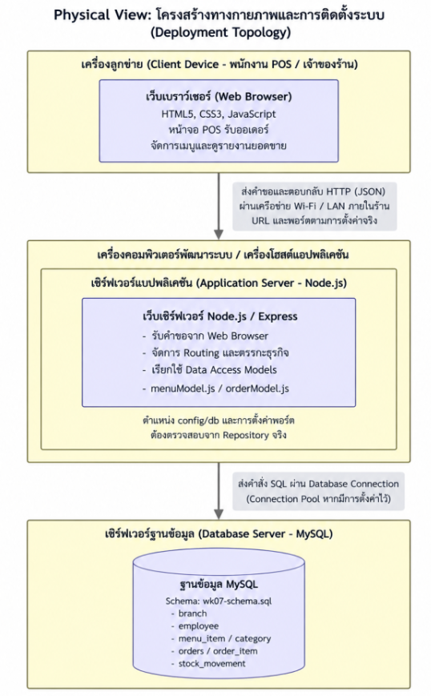
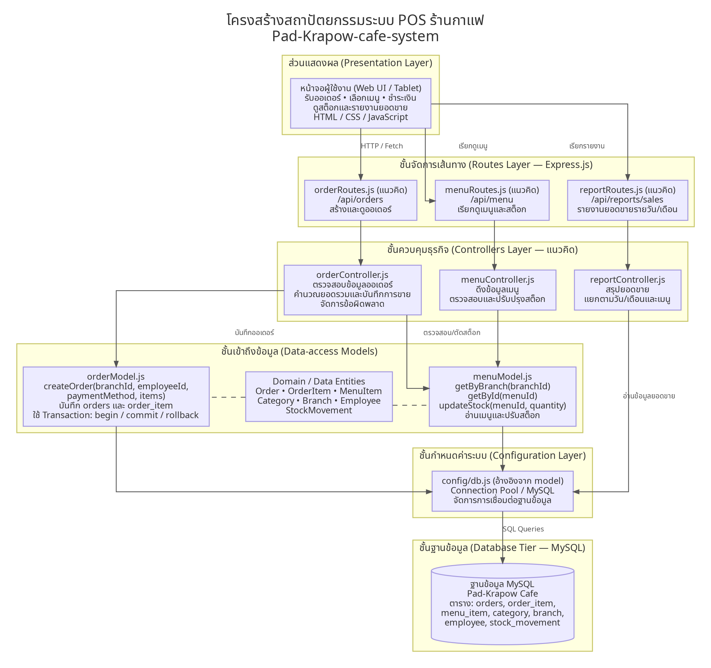

# สถาปัตยกรรมระบบ Pad-Krapow-cafe-system (4+1 Architectural View Model)

## สัปดาห์ที่ 11: การออกแบบระบบ — สถาปัตยกรรมและการแบ่ง Component (4+1 View)

**กลุ่มที่ 1:** Pad-Krapow-cafe
**สมาชิกกลุ่ม:**

1. 67160031 นายธีรเดช อยู่คง
2. 67160030 นายดรัณภพ ทวีพูล
3. 67160039 นายภัคพล ใบเนียม
4. 67160047 นายอภิชาติ ชนะชัย
5. 67160018 นายภูมิพัฒน์ ขันอาสา
---

## 1. Physical View: โครงสร้างทางกายภาพและการติดตั้งระบบ (Deployment Topology)

### คำอธิบายประกอบ Physical View

1. **จำนวน Node:** ระบบแบ่งเป็น 3 node เชิงตรรกะ ได้แก่ เครื่องลูกข่าย (Web Browser ของพนักงาน POS/เจ้าของร้าน), Application Server (Node.js / Express) และ Database Server (MySQL) ซึ่งตามขอบเขตของโครงงาน ทั้งสามส่วนรันอยู่บนเครื่องพัฒนาของกลุ่ม ไม่มีการ deploy ขึ้น cloud และไม่มี load balancer
2. **การสื่อสารระหว่าง node:**
   * Browser → Application Server ใช้ HTTP แลกเปลี่ยนข้อมูลแบบ JSON (เช่น `POST /api/orders` ตาม Sequence Diagram สัปดาห์ 9)
   * Application Server → Database Server ส่งคำสั่ง SQL ผ่าน database connection เมื่อดูจาก `orderModel.js` ที่เรียก `db.getConnection()` แล้วใช้ `beginTransaction()` / `commit()` / `rollback()` แสดงว่า `config/db` เป็น connection pool
3. **โครงสร้างฐานข้อมูล:** ฐานข้อมูล MySQL ใช้ schema ตาม `wk07-schema.sql` มี 7 ตาราง ได้แก่ `branch`, `employee`, `category`, `menu_item`, `orders`, `order_item`, `stock_movement`
4. **การรองรับหลายสาขา:** ตามขอบเขตในหัวข้อ 1.3 ของ `wk11.md` ระบบจำลองหลายสาขาด้วยคอลัมน์ `branch_id` (ตาราง `employee`, `menu_item`, `orders`) ในฐานข้อมูลชุดเดียว ไม่มี Database Server แยกตามสาขา และไม่มีการ sync ข้อมูลข้ามสาขา

---

## 2. Development View: การแบ่ง Component และ Module ของ Source Code

Development View แสดงการแบ่งชั้นของโค้ดภายใน repository เดียวแบบ Layered Architecture ภายใน Monolith ตั้งแต่ Presentation → Routes → Controllers → Data-access Models → Configuration → Database

### การตรวจสอบความสอดคล้องกับ Repository จริง (ตามหัวข้อ 3.4)

| องค์ประกอบใน diagram | สถานะใน repository | หมายเหตุ |
|---|---|---|
| `orderModel.js` | **มีอยู่จริง** | `class OrderModel` มี `static createOrder(branchId, employeeId, paymentMethod, items)` ใช้ transaction (begin / commit / rollback) บันทึก `orders` + `order_item` และตัดสต็อกใน `menu_item` |
| `menuModel.js` | **มีอยู่จริง** | `class MenuModel` มี `getByBranch(branchId)`, `getById(menuId)`, `updateStock(menuId, quantity)` |
| `config/db.js` | **อ้างอิงจากโค้ด** | ทั้งสอง model เรียก `require('../config/db')` จึงมี config อยู่ในโครงสร้างที่ model คาดหวัง แต่ไฟล์นี้ไม่ได้อยู่ในชุดไฟล์ที่ตรวจสอบ |
| Routes Layer (`orderRoutes.js`, `menuRoutes.js`, `reportRoutes.js`) | **แนวคิด** | ระบุ "(แนวคิด)" ใน diagram ไม่มีไฟล์เหล่านี้ในชุดไฟล์ที่ตรวจสอบ |
| Controllers Layer (`orderController.js`, `menuController.js`, `reportController.js`) | **แนวคิด** | ระบุ "(แนวคิด)" ใน diagram เช่นกัน ส่วนหน้าที่ validation ตาม Sequence Diagram สัปดาห์ 9 จึงยังไม่ปรากฏเป็นโค้ดในชุดไฟล์นี้ |
| Domain / Data Entities (`Order`, `OrderItem`, `MenuItem` ฯลฯ) | **ระดับแนวคิด ไม่ใช่ไฟล์** | ใน repo ไม่มีไฟล์ `Order.js` ที่นิยาม `class Order` / `class OrderItem` ตามข้อบังคับ `wk06.md` กล่องนี้จึงเป็นเพียงเอนทิตีเชิงตรรกะจาก Class Diagram และ schema (เส้นประใน diagram) ยังไม่ตรงกับข้อบังคับของสัปดาห์ 6 |
| `wk07-schema.sql` | **มีอยู่จริง** | ตรงกับ 7 ตารางใน Physical View |

**หมายเหตุเรื่องตำแหน่งไฟล์:** ในชุดไฟล์ที่ตรวจสอบ `orderModel.js` และ `menuModel.js` อยู่ที่ root ของ repo แต่โค้ดอ้างถึง `../config/db` แสดงว่าตั้งใจให้อยู่ในโฟลเดอร์ `models/` ที่มี `config/` อยู่ระดับเดียวกัน ชื่อและชั้นใน diagram จึงยึดตามโครงสร้างที่โค้ดคาดหวัง

### ข้อจำกัดที่ diagram ต้องสื่อตามความเป็นจริง

1. **การเขียนข้อมูลออเดอร์มี transaction แล้ว:** `createOrder` ครอบการบันทึก `orders`, `order_item` และการตัดสต็อกไว้ใน transaction เดียว หากขั้นตอนใดล้มเหลวจะ `rollback` ทั้งหมด
2. **การตรวจสอบสต็อกก่อนขายยังไม่ได้อยู่ใน Model:** `createOrder` ลดสต็อกโดยตรงด้วย `stock_quantity = stock_quantity - ?` โดยไม่เช็คว่าพอหรือไม่ ขั้นตอน "ตรวจสอบสต็อกเพียงพอ" ใน Sequence Diagram จึงต้องอยู่ในชั้น Controller ซึ่งเป็นส่วนที่ยังเป็นแนวคิดใน diagram
3. **ตาราง `stock_movement` ยังไม่ถูกใช้ในโค้ดที่ตรวจสอบ:** `orderModel.js` และ `menuModel.js` ไม่มีคำสั่งเขียนลงตารางนี้ ตารางมีอยู่ใน schema และแสดงใน diagram ในฐานะส่วนของฐานข้อมูล
4. **เส้น Controller → `menuModel` ("ตรวจสอบ/ตัดสต็อก") เป็นเส้นเชิงแนวคิด:** ในโค้ดปัจจุบัน `createOrder` ตัดสต็อกเองภายใน transaction ไม่ได้เรียก `MenuModel.updateStock` ส่วน `updateStock` เป็นฟังก์ชันแยกสำหรับกรณีปรับสต็อกจากฝั่งเมนู

---

## 3. สรุปสถาปัตยกรรมของระบบ Pad-Krapow-cafe-system

ระบบของกลุ่ม 1 ใช้สถาปัตยกรรมแบบ **Monolithic ที่จัดโครงสร้างภายในแบบ Layered (Monolithic + Layered)** ด้วยเหตุผลดังนี้

1. **ขนาดทีมและเวลา:** ทีมมีสมาชิก 4 คน และมีเวลาพัฒนาภายใน 1 ภาคการศึกษา การรวมโค้ดไว้ใน repository เดียวและรันเป็น Node.js process เดียวช่วยลดงานด้านโครงสร้างพื้นฐาน เช่น การกำหนด API ระหว่าง service และการ deploy หลายชุด ทำให้ทีมใช้เวลากับฟีเจอร์ของร้านได้มากขึ้น
2. **ขอบเขตระบบ:** ระบบมี 4 ฟังก์ชันหลักที่ใช้ข้อมูลร่วมกัน คือ รับออเดอร์ (POS), จัดการเมนู, ตัดสต็อก และรายงานยอดขาย ข้อมูลทั้งหมดอยู่ในฐานข้อมูล MySQL เดียวและแยกสาขาด้วย `branch_id` ซึ่งทำให้ใช้ database transaction ได้โดยตรง ดังที่ `OrderModel.createOrder` ใช้ครอบการบันทึกออเดอร์และการตัดสต็อกไว้ด้วยกัน การแยกเป็น service จะทำให้เรื่องนี้ยากขึ้นโดยไม่จำเป็น
3. **การแบ่งชั้นภายใน:** แม้ deploy เป็นชิ้นเดียว โค้ดแบ่งความรับผิดชอบเป็น Presentation, Routes, Controllers, Data-access Models (`orderModel.js`, `menuModel.js`) และ Configuration ทำให้สมาชิกแบ่งงานกันได้ เช่น คนหนึ่งทำหน้าจอ POS อีกคนทำ Model และ SQL และปรับแต่ละชั้นได้โดยไม่กระทบชั้นอื่น

ทั้งนี้ ชั้น Routes และ Controllers ใน Development View ยังเป็นแนวคิดตามที่ระบุไว้ใน diagram ส่วนที่ยืนยันได้จากโค้ดคือชั้น Data-access Models และ schema ของฐานข้อมูล

---

## 4. คำถามท้ายบท (Review Questions)

### ข้อ 1: เหตุใด 4+1 View Model จึงต้องมีมุมมองมากกว่าหนึ่งด้านในการอธิบายสถาปัตยกรรมซอฟต์แวร์?

เพราะผู้มีส่วนได้ส่วนเสียแต่ละกลุ่มสนใจสถาปัตยกรรมคนละเรื่อง มุมมองเดียวจึงตอบทุกคนไม่ได้ ในโครงงานร้านกาแฟของเรา:

* **เจ้าของร้านและผู้ใช้:** ดู Scenarios (Use Case) ว่าระบบทำสิ่งที่ร้านต้องการหรือไม่
* **นักวิเคราะห์และนักพัฒนาใหม่:** ดู Logical View (Class Diagram) เพื่อเข้าใจเอนทิตี เช่น `Order`, `OrderItem`, `MenuItem` และความสัมพันธ์
* **นักพัฒนาที่ลงมือแก้โค้ด:** ดู Development View เพื่อรู้ว่าโค้ดอยู่ไฟล์ไหน ชั้นไหนเรียกชั้นไหน
* **ผู้ที่ดูแลการทำงานของระบบ:** ดู Process View (Sequence Diagram) เพื่อเข้าใจลำดับการทำงานของ flow สั่งซื้อ
* **ผู้ติดตั้งและดูแลเครื่อง:** ดู Physical View เพื่อรู้ว่ามีกี่ node และเชื่อมต่อกันอย่างไร

### ข้อ 2: การจับคู่เอกสารจากสัปดาห์ก่อนหน้ากับมุมมองทั้ง 5 ด้าน

| มุมมอง | เอกสารของกลุ่ม | สัปดาห์ | สิ่งที่แสดง |
|---|---|:---:|---|
| Scenarios (+1) | Use Case Diagram (`use-case-diagram.png`) และ User Stories (`wk04-user-stories.md`) | 4 | ผู้ใช้หลัก 3 กลุ่ม (ลูกค้า, บาริสต้า, เจ้าของร้าน) และสิ่งที่ระบบต้องทำให้ |
| Logical View | Class Diagram (`wk06-class-diagram.png`) และ Object Diagram (`wk06-object-diagram.png`) | 6 | คลาสและความสัมพันธ์ของข้อมูลหลักในระบบ |
| Process View | Sequence Diagram (`wk09-sequence-diagram.png`) | 9 | ลำดับ `POST /api/orders` ตั้งแต่ตรวจข้อมูล เช็คสต็อก บันทึกออเดอร์ จนตอบกลับใบเสร็จ |
| Development View | `wk11-development-view.png` | 11 | การแบ่งชั้นของโค้ด และไฟล์ `orderModel.js`, `menuModel.js` |
| Physical View | `wk11-physical-view.png` | 11 | Client, Application Server, Database Server |

### ข้อ 3: เปรียบเทียบ Monolithic กับ Microservices สำหรับโครงงานขนาดเล็ก 1 ภาคการศึกษา

| เกณฑ์ | Monolithic | Microservices |
|---|---|---|
| การพัฒนา | โค้ดอยู่ที่เดียว เรียกฟังก์ชันกันโดยตรง debug ง่าย | ต้องออกแบบขอบเขตของแต่ละ service และ API ระหว่างกัน |
| การทดสอบ | รันทั้งระบบได้ในครั้งเดียว | ต้องรันหลาย service พร้อมกันจึงทดสอบ end-to-end ได้ |
| การ deploy | deploy ชิ้นเดียว | ต้องดูแลหลายชิ้น และมีงานด้านเครือข่ายและ pipeline เพิ่ม |
| ความสอดคล้องของข้อมูล | ใช้ transaction ในฐานข้อมูลเดียวได้ เช่น ตอนสร้างออเดอร์และตัดสต็อก | แต่ละ service มักมีฐานข้อมูลของตัวเอง ต้องจัดการความสอดคล้องเพิ่มเอง |
| การขยายตัว | แยกขยายเฉพาะส่วนได้ยากกว่า ทีมใหญ่ขึ้นแก้ไฟล์ชนกันง่ายขึ้น | ขยายเฉพาะ service ที่ต้องการได้ |
| ความเหมาะกับโครงงานนี้ | **เหมาะ** ทีม 4 คน ขอบเขตจำกัด | ภาระเพิ่มมากเกินกว่าประโยชน์ที่ได้ |

### ข้อ 4: เพราะเหตุใด Architecture Diagram จึงต้องตรวจสอบความสอดคล้องกับ repository จริง?

1. **Diagram ต้องเป็นข้อมูลที่เชื่อถือได้:** ถ้าวาดสิ่งที่ยังไม่มีในโค้ด ผู้อ่านจะเข้าใจผิดว่าระบบทำสิ่งนั้นได้แล้ว ตัวอย่างในงานของเรา คือกล่อง Routes/Controllers ที่ยังไม่มีไฟล์ จึงต้องระบุไว้ว่าเป็นแนวคิด
2. **ใช้เป็นแผนที่นำทางไปยังโค้ด:** นักพัฒนาควรหยิบชื่อกล่องใน Development View ไปเปิดไฟล์จริงได้ทันที เช่น `orderModel.js` และ `menuModel.js` ถ้าชื่อไม่ตรง คนใหม่ในทีมจะเสียเวลาหาและอาจแก้ผิดที่
3. **ใช้ประเมินความเสี่ยงได้ตรงความจริง:** ถ้า diagram บอกว่าตรวจสต็อกก่อนขายแล้ว แต่ใน Model ไม่มีการเช็ค ก็อาจมองไม่เห็นความเสี่ยงที่สต็อกติดลบ ซึ่งโค้ดปัจจุบันยังเกิดขึ้นได้เมื่อเรียก `createOrder` ตรง ๆ

### ข้อ 5: หากขยายเป็น 10 สาขาที่มีเซิร์ฟเวอร์/ฐานข้อมูลของตัวเอง Monolithic ปัจจุบันมีข้อจำกัดอะไร และควรปรับ Physical View กับ Development View อย่างไร?

**ข้อจำกัดของแบบปัจจุบัน**

* **จุดล้มเหลวจุดเดียว:** ทุกสาขาพึ่งเซิร์ฟเวอร์และฐานข้อมูลชุดเดียว ถ้าล่มหรือเครือข่ายหลุด ทุกสาขาขายไม่ได้
* **ภาระและความหน่วง:** ทุกคำสั่งขายวิ่งผ่านเครือข่ายไปเซิร์ฟเวอร์กลาง ช่วงเร่งด่วนอาจช้า
* **ข้อมูลที่แยกกัน:** ถ้าแต่ละสาขามีฐานข้อมูลของตัวเอง เจ้าของร้านต้องมีวิธีรวมยอดขายและสต็อกทุกสาขา

**การปรับ Physical View:** เพิ่ม node ของแต่ละสาขา (เครื่อง POS และ application/database ประจำสาขา) และ node ส่วนกลางสำหรับรวมข้อมูลและรายงาน พร้อมเส้นทางซิงค์ข้อมูลระหว่างสาขากับส่วนกลาง

**การปรับ Development View:** เพิ่ม component สำหรับซิงค์ข้อมูลและพักคิวออเดอร์ที่ยังส่งไม่สำเร็จ และแยกส่วนรายงานรวมไปทำงานฝั่งส่วนกลาง ส่วน `orderModel.js` / `menuModel.js` ยังใช้ต่อในแต่ละสาขาได้ เพราะ query ใช้ `branch_id` อยู่แล้ว

### ข้อ 6: Architecture Diagram ควรสื่อสารข้อจำกัดของ flow สั่งซื้อและตัดสต็อกอย่างไร และเหตุใดการวาดให้ดูสมบูรณ์เกินจริงจึงเป็นปัญหา?

โจทย์ในสัปดาห์นี้ยกกรณีที่ `createOrder` ยังไม่มี transaction แต่ในโค้ดของกลุ่มเรา `OrderModel.createOrder` **มี transaction แล้ว** (`beginTransaction`, `commit`, `rollback`) ดังนั้น diagram ต้องสื่อข้อเท็จจริงทั้งสองด้านให้ตรงกับโค้ด:

* **สิ่งที่โค้ดทำได้จริง:** การบันทึก `orders`, `order_item` และตัดสต็อกเป็น transaction เดียว ถ้าขั้นตอนใดผิดพลาดจะ rollback ทั้งหมด ซึ่งระบุไว้ในกล่อง `orderModel.js` ของ diagram
* **สิ่งที่ยังไม่มี:** การเช็คว่าสต็อกพอก่อนตัดยังไม่อยู่ใน Model, ตาราง `stock_movement` ยังไม่ถูกเขียนโดยโค้ดที่ตรวจสอบ และชั้น Routes/Controllers ยังเป็นแนวคิด จึงระบุไว้ใน diagram และในข้อ 2 ของหัวข้อ "ข้อจำกัดที่ diagram ต้องสื่อ"

**ทำไมการวาดให้สมบูรณ์เกินจริงจึงเป็นปัญหา:** ผู้ที่นำ diagram ไปใช้ตัดสินใจจะเชื่อว่าระบบปลอดภัยกว่าที่เป็น เช่น คิดว่ามีการกันสต็อกติดลบไว้แล้วจึงไม่ตรวจสอบเพิ่ม หรือคิดว่ามี Controller อยู่แล้วจึงวางแผนงานผิด ในทางกลับกัน การไม่แสดงสิ่งที่ทำได้จริงก็ทำให้ภาพผิดเช่นกัน diagram จึงควรบอกทั้งสิ่งที่มีและสิ่งที่ยังไม่มีให้ตรงกับโค้ดปัจจุบัน
